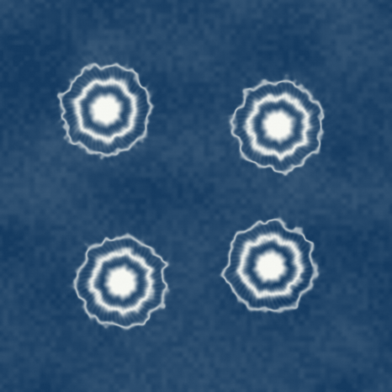
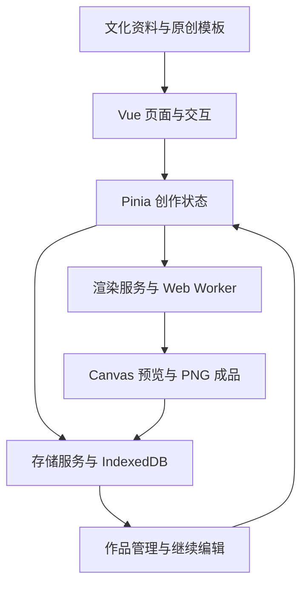

<div align="center">


# 染见白乡 · Bai Indigo

**白族扎染工艺数字体验与创新传播平台**

在蓝与白之间，认识一门工艺，亲手完成一方染作。


[项目介绍](#项目介绍) · [功能体验](#功能体验) · [快速开始](#快速开始) · [技术实现](#技术实现)



<sub>项目 Demo 导出的原创数字体验作品</sub>

</div>

## 项目介绍

扎结留下空白，浸染带来色彩，拆线之后，纹样才完整显现。

**染见白乡**围绕白族扎染，将工艺知识、文化资料与数字创作结合在同一个网页中。用户可以阅读扎染资料、了解防染原理，也可以从一块数字布面开始，布置扎结、选择折叠方式、调整染色深浅，体验浸染、氧化与拆线，生成并保存自己的蓝白作品。

项目采用靛蓝与暖白的视觉风格，提供桌面和手机布局。创作、图像生成和作品存储均在浏览器中完成，无需自建业务后端。

## 功能体验

| 模块         | 可以做什么                                                   |
| ------------ | ------------------------------------------------------------ |
| **染艺寻踪** | 按分类浏览工艺与地域、纹样等文化资料，查看图文详情及参考来源。 |
| **一布一染** | 了解扎缠防染的基本原理，阅读术语与常见问题，并进入数字创作。 |
| **掌上扎染** | 添加、移动、删除扎结，调整半径、折叠方式和染色深浅，实时观察图案变化。 |
| **纹样工坊** | 从四方纹、单花纹、折叠条纹、自由扎结四种原创体验方案开始创作。 |
| **染作生成** | 查看本地保存的作品，重命名、下载、删除或继续编辑。页面标题为“我的作品”。 |
| **白乡故事** | 阅读创作手记、人物传承与文化传说，查看图片说明和资料来源。   |

### 从创作到保存

1. **选择方案**：使用现有模板，或从自由扎结开始。
2. **布置扎结**：调整位置、大小、折叠方式与颜色深浅，查看实时预览。
3. **完成制作**：经历浸染、氧化与拆线，展开最终染作；可跳过过程动画。
4. **保存与比较**：下载 PNG，在“我的作品”中管理成品，或比较最近两次完成的染作。

### 核心能力

- **交互编辑**：支持点选、拖动、镜像点调整、单点或整体半径设置；最多放置 12 个原始扎结，保留 30 次有效撤销。
- **实时生成**：通过 Web Worker 计算数字染色效果，预览与成品共用核心算法；成品以 **1024 × 1024 PNG** 导出。
- **草稿恢复**：编辑后自动保存草稿，也可立即保存；在同一浏览器、同一站点重新打开时恢复创作参数。
- **作品管理**：拆线完成后自动保存成品，可查看、重命名、删除、下载和继续编辑；再次制作会生成独立的新作品。
- **操作反馈**：为计算失败、存储失败和图片加载失败提供提示与相应处理入口；详情支持键盘关闭及焦点恢复。

## 快速开始

### 环境要求

- **Node.js 24.11.0 或以上版本**。
- **pnpm 11.25.0**，与 `app/package.json` 中的 `packageManager` 保持一致。
- 支持 Canvas、Web Worker 和 IndexedDB 的现代浏览器。

### 启动正式工程

```sh
git clone https://github.com/ChadBi/bai-indigo.git
cd bai-indigo/app
pnpm install --frozen-lockfile
pnpm dev
```

默认开发地址为 `http://127.0.0.1:5173/`，以终端实际输出为准。打开后默认进入“掌上扎染”。

### 检查与构建

以下命令均在 `app/` 中执行：

```sh
pnpm typecheck
pnpm test
pnpm build
pnpm preview
```

构建结果输出到 `app/dist/`，可由静态站点服务托管。项目使用 Hash 路由，Vite 资源基础路径配置为相对路径。部署时应通过 HTTP 或 HTTPS 访问构建结果。

### 单文件原型

`demo/index.html` 保留早期交互原型，可直接用浏览器打开。**正式工程位于 `app/`**，功能和导出尺寸以正式工程为准。

## 技术实现

| 技术                   | 作用                                      |
| ---------------------- | ----------------------------------------- |
| Vue 3 + TypeScript     | 组件化界面、数据类型与交互逻辑。          |
| Vite + pnpm            | 本地开发、依赖管理和生产构建。            |
| Vue Router + Pinia     | 页面导航、创作参数及作品状态管理。        |
| Canvas 2D + Web Worker | 布面绘制、像素计算、过程展示和 PNG 生成。 |
| IndexedDB              | 保存草稿、成品图像、缩略图和编辑参数。    |
| Vitest + Playwright    | 核心逻辑测试与浏览器交互回归检查。        |



界面负责收集操作，引擎负责生成图案，存储服务负责保存与恢复。预览与成品使用独立的计算任务，并通过取消旧任务和过滤过期结果，避免较早的计算覆盖最新方案。

### 代码位置

| 路径                                     | 内容                                     |
| ---------------------------------------- | ---------------------------------------- |
| [`app/src/app/`](app/src/app/)           | 页面布局、路由和全局样式。               |
| [`app/src/modules/`](app/src/modules/)   | 创作、模板、作品、学习、文化与故事模块。 |
| [`app/src/engine/`](app/src/engine/)     | 数字扎染像素算法与 Worker 入口。         |
| [`app/src/stores/`](app/src/stores/)     | 创作状态、编辑历史与作品状态。           |
| [`app/src/services/`](app/src/services/) | 渲染、图像编码、制作流程及本地存储服务。 |
| [`app/src/content/`](app/src/content/)   | 文化内容、故事、来源与原创模板数据。     |
| [`app/src/shared/`](app/src/shared/)     | 公共组件、共享类型和参数校验。           |
| [`tests/`](tests/)                       | 浏览器交互测试脚本。                     |
| [`reference/`](reference/)               | 项目书、参考资料与原型展示材料。         |

## 使用说明

### 作品保存在哪里？

草稿与作品保存在**当前浏览器、当前站点的 IndexedDB** 中。换浏览器、换设备或换站点地址后，不会自动同步；清除网站数据也会删除这些记录。重要作品建议及时下载 PNG。

最近两次染作的对比记录在刷新后清空，已成功保存的作品仍可从“我的作品”中打开。保存失败的成品暂留在当前应用会话内，可跨页面重试或下载；刷新前应先处理待保存结果。

### 数字效果与传统工艺是什么关系？

数字创作通过平面镜像和像素计算表达折叠、防染与色晕，是对工艺原理的艺术化近似。

