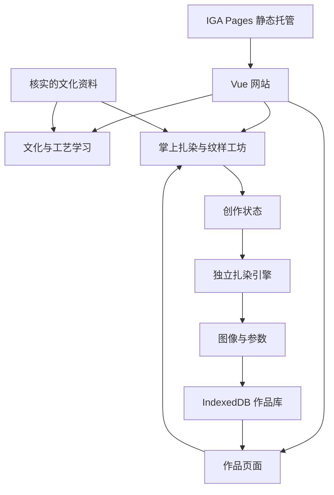

# 正式系统架构与实施顺序

本文件是开发基线。app/ 已完成工程骨架、完整 Demo 交互、纯像素引擎、Worker、IndexedDB 草稿、PNG 下载、会话对比和队友模块样例；持久化作品库与完整内容仍在后续实施范围。

## 技术选择

- Vue 3 + TypeScript + Vite：组件与构建工程。
- Vue Router：页面导航；初版可采用 hash 模式避免静态托管刷新子路由 404。使用 history 模式前配置并验证托管端的回退规则。
- Pinia：共享创作状态与界面状态。
- Canvas 2D：布面编辑、结果显示与图片导出。
- Web Worker：独立进行像素计算，主线程接收结果后绘制。
- IndexedDB：保存草稿、作品参数、缩略图和 PNG Blob。
- 结构化内容文件：工艺资料、故事、来源及图片。
- CSS 变量和公共组件：统一靛蓝与白色视觉。
- IGA Pages：发布静态构建产物。第一版业务运行在浏览器中。

## 结构



界面收集操作，引擎生成图案，存储服务负责读写数据。算法不依赖 Vue 组件，页面不直接处理数据库细节。

## app/src 目录

```text
app/src/
  app/                 路由、全局布局、样式
  shared/              公共组件、类型与工具
  modules/
    culture/           队友 A 的资料展示
    stories/           队友 B 的图文故事
    learning/glossary/ 队友 C 的术语与常见问题
    learning/          工艺教学主流程
    studio/            创作界面
    patterns/          模板与工坊
    works/             结果与作品管理
  engine/              扎染算法、计算线程
  stores/              创作状态
  services/            内容与存储服务
  content/             统一核对的文化数据
```

## 数据契约

共享 TypeScript 类型位于 app/src/shared/types.ts，校验位于 shared/validation.ts。Renderer、DraftRepository 已有实现；WorksRepository 仅定义接口，尚无作品适配器。

- DyeParams：schemaVersion、engineVersion、seed、style、fold、depth、knots；每个 knot 有稳定 id、归一化 x/y 和 radius。
- DyeWork：id、name、createdAt、updatedAt、params、thumbnail Blob、image Blob。
- Draft：params、updatedAt、templateId、defaultRadius；恢复参数后重新计算预览，不恢复半截动画。
- SessionDyeResult：冻结的 params、image Blob、thumbnail Blob、createdAt；Pinia 仅保留最近两次完成结果，不写入数据库。
- CultureEntry / StoryEntry：id、title、summary、body、images、sourceRefs、relatedPatternIds；标明 traditional 或 original 类型。

坐标不依赖屏幕像素。seed 与 engineVersion 一起保存，使历史方案有明确的重现条件。生成与保存的数据需要校验范围和版本。

IndexedDB 使用项目专属名称 `bai-indigo`，以免通用 Demo 域名上的不同应用互相混用记录。只保存当前浏览器的个人数据，配套方案文件导出。存储失败、空间不足或隐私模式异常应有可恢复反馈，不宣称数据永久可靠。

## 引擎与状态

当前预览分辨率 260×260。engine/dye.ts 从 Demo 提取，算法版本 demo-resist-v1，参数版本 1。WorkerRenderer 为每次请求创建 Worker，新请求终止旧 Worker；成功、失败、取消和超时均清理线程。主线程另用 requestId 防止旧结果绘制，退出创作页也取消请求。

stores/studio.ts 先读取和校验草稿，再开启参数编辑与自动保存。services/storage.ts 建立 bai-indigo v1 的 drafts、works 仓库，串行提交草稿，失败后允许重试。未知／损坏草稿不会自动覆盖；明确重置才删除。500ms 自动保存尚未提交时关页可能丢失最后修改；多标签页冲突合并尚未实现。

当前完整制作与下载实现：

状态流程：编辑 → 准备图像 → 浸染 → 氧化 → 等待拆线 → 展开 → 完成。准备阶段冻结参数并计算、编码 1024 成品；浸染／氧化总计 3.4 秒，62% 转入氧化；拆线展开 1.1 秒。动画表达过程，不改变成品。减少动态效果模式仍保留拆线动作。

services/process.ts 使用独立成品 Renderer、AbortSignal 和任务代次，过滤过期计算及编码；退出时取消 rAF 和任务。modules/studio/drawing.ts 绘制白布、扎结及制作画面。DyeCanvas 预览最多每 80ms 发起一次；成品预览、下载均使用同一次计算的像素。

编辑快照覆盖参数、templateId、defaultRadius，历史上限 30；连续拖动／滑杆只提交一次，选择和无变化操作不入历史。原始点稳定 ID 用于选择与映射点反算；指针取消回退整个当前事务。草稿结构和版本未改变。

渲染服务接收参数、目标尺寸和 requestId，返回像素数据或错误。预览使用小尺寸，正式导出先做 1024×1024；更高分辨率按实际性能扩展。过期计算结果不得覆盖最新参数。生成错误、取消任务及退出页面都要正确结束 loading 状态。

重用 Demo 的 effectivePoints、距离/遮罩、色阶、噪声等思路，改进扎法辨识度与色晕。预览和导出使用同一参数和核心算法；不同分辨率要求图案结构一致，不要求逐像素相同。

正式版本使用 toBlob 生成导出图像，以免把所有大图长期存成 Base64 字符串。Worker 内不直接操作页面 DOM；主线程负责 Canvas 展示、指针交互与动画。

## 服务边界

ContentRepository 读取资料；WorksRepository 提供草稿和作品的读写；Renderer 负责计算。后续云端保存可替换存储服务实现，不要求重写每个页面。

## 顺序与完成标准

1. 骨架：已建立 app/、锁文件、路由、公共组件、类型、队友入口，并接通 Worker 和草稿。
2. 迁移：已接通布面编辑、制作过程、1024 PNG 和两次会话对比；Demo 保留。
3. 闭环：草稿恢复、作品库、命名与删除、方案导出/导入、继续编辑。
4. 内容：工艺教学、纹样解释与文化卡片接入当前步骤。
5. 队友：合并各展示模块，检查数据、样式和响应式。
6. 发布：检查完整流程、导出、恢复、正式域名访问与缓存。

核心检查包括：折叠映射正确，参数变化有可辨认效果，刷新后草稿可恢复，保存失败可处理，旧渲染不覆盖新结果，图片可导出，手机拖动不会误触滚动。
